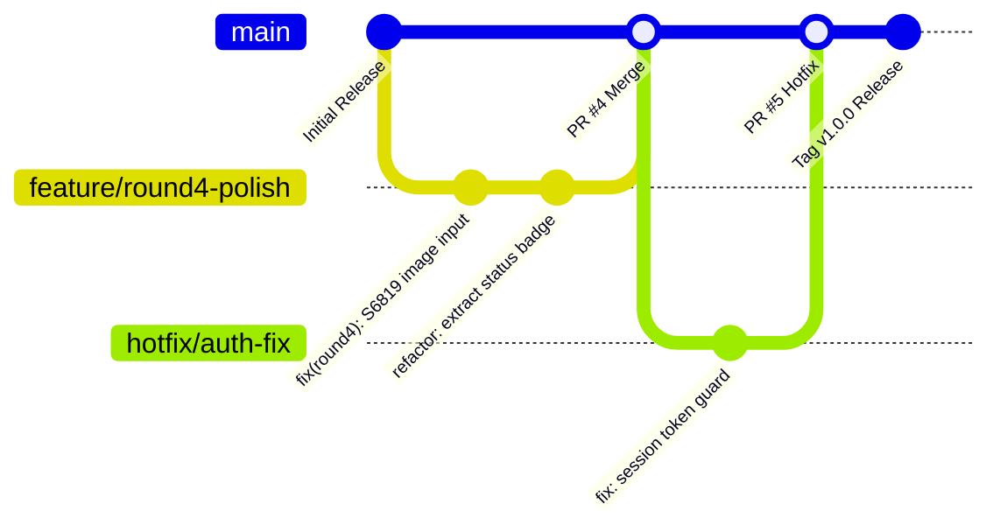

# FROST CARTEL — TEAM DEVELOPMENT WORKFLOW & COLLABORATION GUIDE

This document establishes the official software development lifecycle, branch policies, pull request procedures, and release standards for developers contributing to **Winter Arc — Frost Cartel**.

---

## 1. Branch Strategy (Trunk-Based with Feature Branches)

We employ a structured **Trunk-Based Development** model with short-lived feature and round branches that integrate continuously into `main`.

### Branch Naming Conventions:
- **Feature Branches:** `feature/<round-or-module>-<description>` (e.g. `feature/round4-clue-visualizer`)
- **Bugfixes:** `fix/<issue-description>` (e.g. `fix/dove-animation-jitter`)
- **Documentation:** `docs/<document-name>` (e.g. `docs/api-guide`)
- **Hotfixes:** `hotfix/<critical-patch>` (e.g. `hotfix/sqlite-wal-lock`)

---

## 2. Pull Request Standards & Required Quality Gates

Every pull request targeted at `main` must pass the automated GitHub Actions CI pipeline and meet the following mandatory criteria before merging:

1. **Clean Linting:** Zero warnings or errors from `npm run lint` (`oxlint`).
2. **Strict TypeScript Compilation:** `npx tsc -b` must complete with 0 errors.
3. **Full Automated Test Coverage:** All Vitest suites must pass (18 test files, 81 tests).
4. **Successful Production Bundle:** `npm run build` must succeed without unresolved imports.
5. **Clean Code & SonarQube Compliance:**
   - No `async` functions without `await` expressions (S7503).
   - Prefer optional chaining over verbose truthiness guards (S6582).
   - All interactive visual elements must use accessible `<input type="image">` or `<button>` wrappers (S6819).
   - All `<svg>` icons must have `<title>` or `aria-hidden="true"` (S1077).
   - No nested ternary expressions in JSX render trees (S3358).

---

## 3. Codeowners & Review Policy

Ownership is enforced declaratively through `.github/CODEOWNERS`:

- Global Reviewer: `@pratham250206`
- Core UI / Game Views: `/src/`
- Backend API / Database: `/server/`, `/database/`
- CI/CD & Deployments: `/.github/`

A minimum of one approving review from the designated codeowner is required for merging into `main`. Force-pushing (`git push --force`) to `main` is protected and strictly forbidden.
